# Assessment Module — Complete Client Requirements

This file contains the full content of both client documents, converted for use in Kiro IDE. Part A is the product specification. Part B is the coach-led assessment form.

---

# Part A — Assessment Module Details

Source file: Assetment_Module_Details_1.docx

> Content is kept in the original order. Images are in `assets/`. Source citation labels (for example “NIDDK”, “PubMed”, “+1”) are kept as they appeared in the source.

## 1. What should we track?

Let separate the inputs into five groups. Not every measurement needs to come from the camera; some should come from a scale, a tape measure, a questionnaire, or a qualified coach.

## 2. The assessment data model

Recommended for your Fitness OS · initial product specification

### A. Personal baseline and goal

Capture at onboarding and update when relevant.

- Age, height, sex-related inputs required by the selected estimation equation

- Current weight and target weight or target body-composition range

- Primary goal: fat loss, muscle gain, recomposition, strength, endurance, mobility or general wellness

- Training experience, preferred activities, available days and session duration

- Injury limitations, relevant health considerations, medication-related considerations and exercise clearance where appropriate

- Lifestyle: daily activity, occupation, sleep, stress, dietary pattern and food preferences

### B. Body measurements and composition

- Height and body weight

- Waist circumference; optionally hip, chest, upper arm, thigh and calf circumference

- Waist-to-height ratio and waist-to-hip ratio where suitable

- Body-fat percentage, fat mass and fat-free mass only when supported by a suitable measurement method or a clearly labelled estimate

- Skeletal muscle mass, if the selected device actually measures or estimates it

- Front, side and back reference images, with explicit consent

Use the scale and a standardised tape measurement to complement the camera. A camera image alone cannot reliably determine all internal body-composition measures.

### C. Functional fitness

- Resting heart rate, if available from a suitable device

- Strength tests appropriate to the person's ability

- Cardiorespiratory endurance test

- Mobility, flexibility, balance and posture

- Movement quality: squat, hinge, lunge, push, pull and other relevant patterns

- Recovery, perceived exertion and exercise tolerance

These require separate validated tests or coach-led protocols. They cannot all be inferred from a standing body scan.

### D. Metabolism and nutrition

- Resting Metabolic Rate (RMR), measured or estimated with the method recorded

- Total Daily Energy Expenditure (TDEE), estimated from RMR and activity

- Daily calorie target and protein, carbohydrate, fat and fibre targets

- Dietary pattern, meal timing, food preferences and restrictions

- Actual food intake, hydration and adherence over time

Nutrition targets should be generated from the complete profile and reviewed as progress data accumulates—not set from BMI alone.

### E. Progress and adherence

- Weekly weight trend, not just individual readings

- Periodic body circumferences and standardised photos

- Training attendance, completed sessions, loads, repetitions and performance

- Nutrition adherence, steps/activity, sleep and recovery

- Reassessment results, deviations from expected progress and coach adjustments

These records allow the system to revise the timeline instead of promising a fixed result on day one.

## 3. Do we need RMR and BMI?

Yes, but they serve different purposes—and neither is enough on its own.

| Metric | Should you track it? | How Fitness OS should use it |
| --- | --- | --- |
| BMI | Yes, if adult height and weight are available | A screening/context measure, not a direct measure of body fat or muscularity. American Diabetes Association +1 |
| RMR | Yes, as measured or estimated | Estimates the energy used at rest; it is not the person's complete daily calorie requirement. |
| TDEE | Yes | The estimated daily energy expenditure used as a starting point for nutrition planning. |
| Body-fat percentage | Yes, when the method is suitable | Helps distinguish fat-loss goals from muscle-gain or recomposition goals; show the method and uncertainty. |
| Waist circumference | Strongly recommended | Adds a useful measure of body-size change that BMI alone misses. |
| Lean mass / muscle mass | Where measurement quality supports it | Helps assess whether a programme is preserving or building lean tissue. |
| Strength and endurance | Yes | Measures functional improvement even when body weight changes little. |
| Sleep, recovery and adherence | Yes | Helps explain why results differ from the initial estimate and informs plan adjustments. |

BMI is calculated as:

\[ \mathrm{BMI}=\frac{\mathrm{weight\ (kg)}}{\mathrm{height\ (m)}^2} \]

RMR can be measured using indirect calorimetry or estimated using a validated equation. If it is estimated, the interface must say so. The system should then estimate TDEE using an activity model and calibrate it against observed weight trends and adherence over time. The NIDDK's Body Weight Planner is a useful reference for the principle of personalising calorie and activity plans.

NIDDK

+1

### How should calorie targets work?

The logic should be:

- Estimate or measure RMR.

- Estimate TDEE using activity and training patterns.

- Select a goal-appropriate calorie target, with suitable guardrails.

- Set protein and other nutrition targets according to the person's goal and circumstances.

- Track intake and actual outcomes.

- Reassess and adjust with a qualified coach or nutrition professional.

For example, a person pursuing fat loss may start with a moderate energy deficit, whereas a person aiming to gain muscle may need a different energy and protein strategy. Recomposition needs to account for training experience, baseline body composition and adherence.

Important: do not automatically prescribe a calorie target just because someone has a high BMI, nor treat a calculator output as a medical prescription. Flag cases requiring professional review, including minors, pregnancy, eating-disorder risk, significant medical conditions and unusually low proposed intake.

## 4. The clothing problem: what can we actually achieve?

My recommendation is to design a privacy-first, two-mode assessment, because a camera cannot reliably reconstruct the exact body underneath every loose garment.

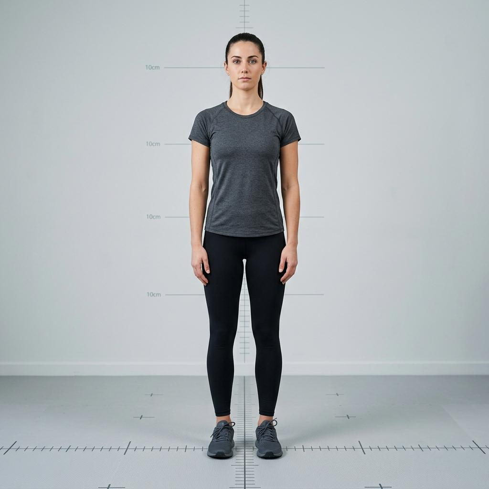

**Mode A — Public studio assessment**

Default

The member can remain in ordinary, non-revealing clothing.

- Capture height/weight separately, posture, visible alignment and movement.

- Use camera measurements only where the garment and capture quality support them.

- Run a quality check for loose fabric, occlusion, lighting, body framing and pose.

- Mark unreliable body dimensions as “not measurable in this scan” rather than inventing precise values.

- Offer a private follow-up measurement if the member wants greater accuracy.

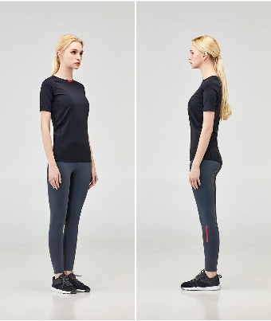

**Mode B — Higher-confidence body assessment**

For more reliable circumference and body-shape measurements, invite the member to a private assessment using consistent, close-fitting athletic clothing, if they are comfortable.

- Front, side and back capture under controlled conditions.

- Scale and standardised tape measurements for cross-checking.

- Optional validated body-composition equipment.

- Explicit consent and access restrictions for photographs and body data.

This must be optional—not a condition of receiving training or joining the studio.

### What if the person insists on loose clothing?

The system should still provide a useful assessment, but distinguish observed measurements from estimates.

For example:

- Weight: 82.4 kg — measured on scale.

- BMI: 26.8 — calculated from measured height and weight.

- Posture: visible shoulder asymmetry flagged for coach review.

- Waist circumference: not reliably measurable from this image.

- Body-fat percentage: not established by this scan.

- Transformation visual: available as an illustrative goal preview, with lower confidence in body-shape detail.

This is much more trustworthy than showing “23.7% body fat” just because the AI produced a number.

Research on smartphone body-scanning systems supports this distinction: repeatability can be high while estimates still differ materially from reference methods. Standardised acquisition and validation matter.

PubMed

+1

There is research into compensating for marginally loose clothing, but that does not establish that every garment, body type and pose can be measured accurately.

Abstracts, Papers, Presentations

Product decision: do not market the public-area camera as a precise body-fat scanner unless the chosen technology has been independently validated for your actual clothing and capture conditions.

## 5. How to make the transformation photo look real

This is where I would be especially careful. Do not ask a general-purpose image generator to create a “better version” of the person from scratch. That is the easiest way to change their face, body proportions, pose, clothing and skin texture.

Instead, build a controlled transformation-image pipeline.

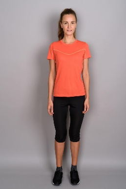

**Step 1 — Lock the reference**

Store the approved baseline image, camera angle, crop, lens position, background, lighting, foot position and pose landmarks. Keep the original immutable.

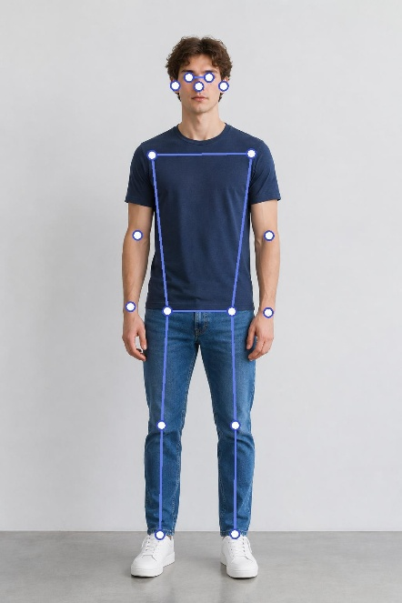

**Step 2 — Lock identity and pose**

Use person segmentation and pose landmarks to keep the head, face, hands, feet, camera perspective and joint positions consistent. Flag images that do not match the reference pose closely enough.

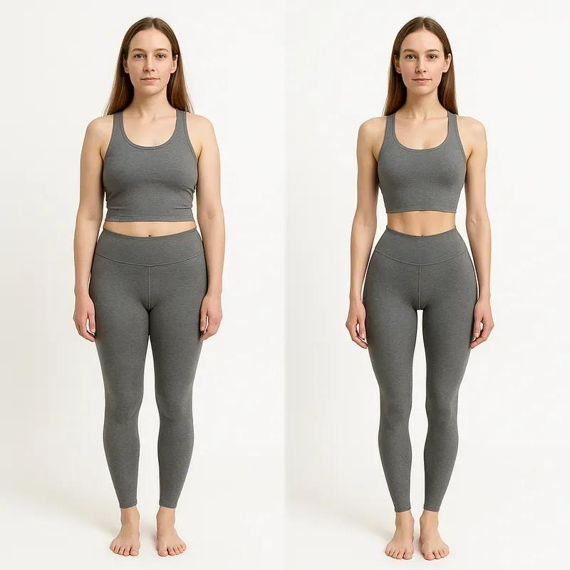

**Step 3 — Apply constrained changes**

Use body-shape editing or a validated 3D body model guided by plausible circumference and composition changes. Preserve identity and natural proportions. Do not arbitrarily add abs, enlarge shoulders or narrow the waist.

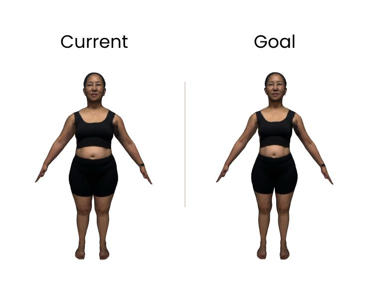

**Step 4 — Show an honest comparison**

Present “Starting point” and “Illustrative goal” side by side. Preserve the same framing and pose; disclose that the goal is a simulation, not a guaranteed prediction.

The images above illustrate the intended style and workflow; they do not demonstrate that a particular model can preserve identity or produce accurate body-shape changes. That needs to be tested with the actual image-processing technology you select.

### The pose consistency rules

| Rule | Implementation requirement |
| --- | --- |
| Camera | Fixed height, distance, focal length and framing |
| Position | Marked foot locations and standardised stance |
| Pose | Front, side and optional back view captured with repeatable instructions |
| Clothing | Record clothing-fit quality; don't infer hidden anatomy from fabric folds |
| Lighting | Consistent, even illumination and background |
| Identity | Keep the original image and prevent face/identity regeneration |
| Body changes | Apply changes constrained by the target measurements and goal |
| Validation | Reject or flag results with warped limbs, altered pose, inconsistent shadows or implausible proportions |

For the first version, I would use a fixed front and side pose, adding the back view only if the chosen technology benefits from it. Multi-image capture can improve geometric information, but more photos do not automatically guarantee accurate body-fat estimates.

PubMed

+1

## 6. How should the system calculate the transformation timeline?

The timeline must be based on a combination of target, baseline and expected adherence—not on the AI image.

For example, a member's goal could be:

- Reduce waist circumference by a selected amount.

- Improve strength and conditioning.

- Preserve or increase lean mass.

- Attend three training sessions a week.

- Follow a personalised nutrition plan.

The system should then produce an estimated range, with the assumptions visible to the coach and member. Recalculate it at reassessment using the actual trend in weight, circumference, performance, training attendance and nutrition adherence.

Don't promise a specific appearance by a fixed date. The system should say what the person is working toward, what plan supports it, and how progress will be checked.

## 7. The screen I would build for your Assessment module

GOAL-TO-TRANSFORMATION

## Your goal. Your journey.

Illustrative preview

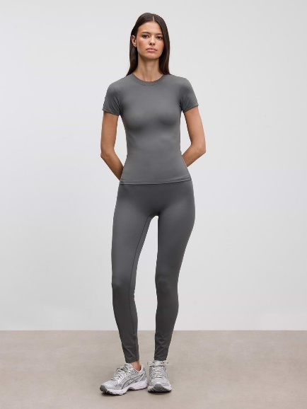

Starting point

Baseline assessment

Illustrative goal

generated before/after of a real member.

Nutrition plan

### Personalised

Calories and macros from baseline assessment

Target timeline

### Estimated range

Updated at reassessment

Your plan

Assess

Baseline, goals and confidence of measurements

Train and nourish

Coach-approved training and nutrition plan

Measure and adapt

Progress evidence, reassessment and timeline updates

## 8. What I would insist on before launch

- Measurement confidence: every value is tagged as measured, calculated, estimated or unavailable.

- Validation: test across different body types, genders, skin tones, clothing fits, lighting and poses against appropriate reference measurements.

- Image honesty: no face replacement, exaggerated muscle generation or hidden-body precision claims.

- Privacy: explicit consent for capture and transformation previews; private alternatives; role-based access; retention/deletion controls. Avoid keeping raw images longer than necessary.

- Coach approval: nutrition and training plans can be reviewed and adjusted by qualified professionals.

- Progress evidence: the actual member's later photos and measurements remain distinct from simulated goal images.

### My recommendation

Build the assessment around three separate outputs:

- Measured baseline — the most reliable data available from scale, questionnaire, tape and validated tools.

- Personalised action plan — estimated energy needs, nutrition targets, training programme and an adjustable timeline.

- Transformation preview — a clearly labelled, pose-consistent illustration constrained by the target and confidence of the input data.

That combination is what makes this a serious Fitness OS feature rather than a gimmick.

The one decision that will materially affect the implementation is this: what camera setup are you planning for the main studio area—an ordinary tablet/mobile camera on a stand, a dedicated 3D body scanner, or a multi-camera setup? The right measurement and clothing strategy depends heavily on that choice.

For your premium fitness studio, I would build a standardised Functional Fitness & Movement Assessment that can be used across age groups—from young adults to older members, beginners to experienced athletes.

The important point is that everyone should follow the same assessment framework, but not necessarily perform the same exercise or difficulty level. A pull-up might be appropriate for a trained 25-year-old, while a supported sit-to-stand test may be more appropriate for an older adult or someone returning after an injury.

Your objective should be to measure each member’s baseline, identify improvement areas, recommend training, and repeat the tests to demonstrate progress—not simply rank members by strength.

## 1. Recommended assessment battery

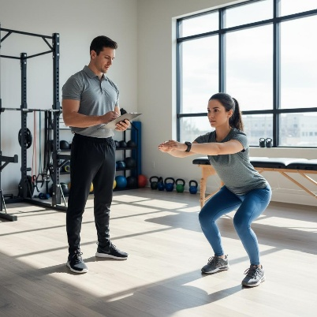

### A. Lower-body strength and movement

What it measures: leg strength, control, stability and functional movement.

- Bodyweight squat or squat-to-box

- 30-second chair stand

- Step-up test

- Single-leg sit-to-stand, as an advanced option

Record: repetitions, depth/target height, assistance required, balance and movement quality.

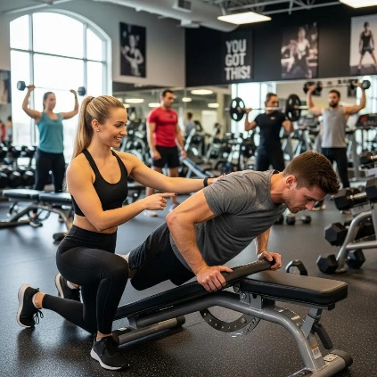

### B. Upper-body strength

What it measures: pushing and pulling capacity.

- Push-ups: wall → incline → knees or floor → advanced variations

- Seated cable row or resistance-band row

- Assisted pull-up or controlled pull-up

- Grip strength using a dynamometer, if available

Record: repetitions, assistance/load, range of motion and technique. Use the same setup during reassessment.

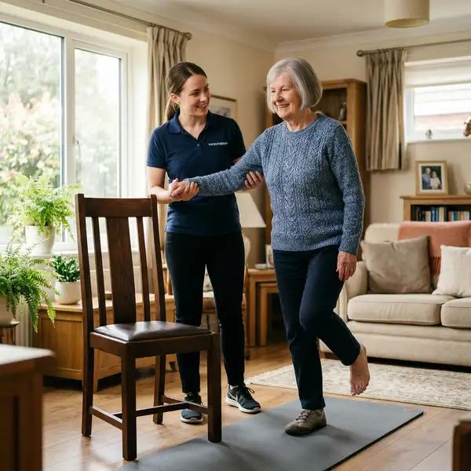

### C. Balance and stability

What it measures: control during standing and everyday movement.

- Tandem stance

- Single-leg balance, with support available

- Controlled step-over

- Timed Up and Go (TUG), especially for older adults or people with mobility concerns

Record: seconds, support used, balance loss and assistance required. Do not test unsupported balance where fall risk is elevated.

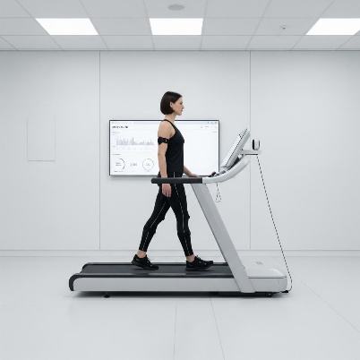

### D. Cardiovascular endurance

What it measures: exercise tolerance and aerobic fitness.

- Treadmill walking or a standardised submaximal treadmill protocol

- 2-minute step test

- 6-minute walk test where space and protocol allow

- Stationary-cycle test as a lower-impact alternative

Record: duration, speed/incline or step count, perceived exertion and heart-rate response when appropriate. Avoid making maximal treadmill running mandatory for every member.

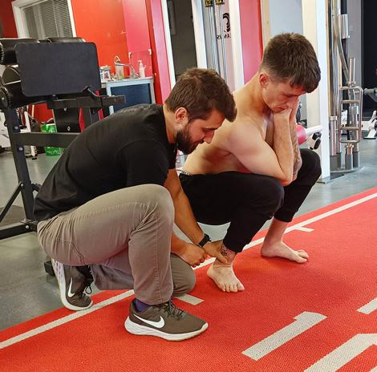

### E. Mobility and flexibility

What it measures: usable range of motion for training and daily activity.

- Shoulder mobility reach

- Ankle knee-to-wall test

- Sit-and-reach or an appropriate hamstring mobility test

- Overhead reach and squat mobility screen

Record: range or distance, side-to-side differences, discomfort and compensatory movement. Mobility screens are not diagnoses.

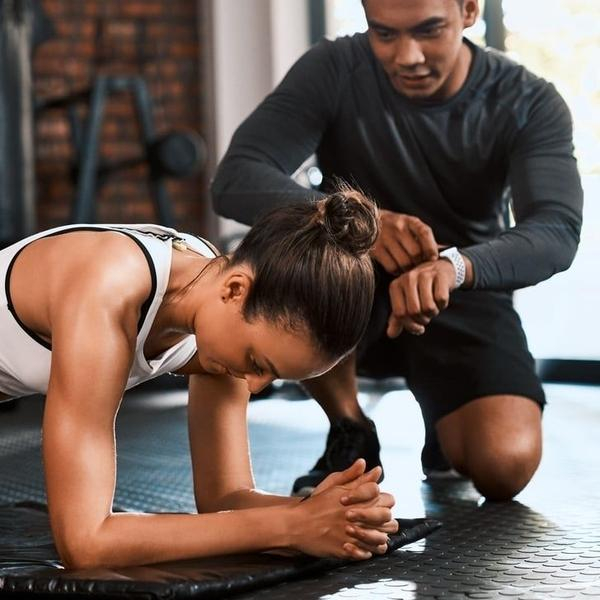

### F. Core endurance and functional capacity

What it measures: trunk control and ability to perform everyday tasks.

- Modified plank or standard plank

- Suitcase carry or farmer's carry, with a suitable load

- Controlled step-up and step-down

- Floor-to-stand transfer, where relevant and safe

Record: time, load, distance, assistance and quality of control. Stop at the prescribed technique limit rather than encouraging exhaustion.

## 2. Which tests should be used for which age groups?

Use one common assessment library with adaptive protocols, rather than creating a completely different program for every age.

| Member profile | Recommended starting tests |
| --- | --- |
| Young adults and beginners | Squat-to-box, scaled push-up, row, balance, mobility, submaximal cardio |
| Experienced or athletic adults | Standardised squat, push-up, pull-up/row, plank, cardio and goal-specific performance tests |
| Adults 40–59 | Strength, chair stand, balance, mobility and submaximal cardio; adapt for training history and health |
| Adults 60+ | Chair stand, supported balance, mobility, walking or step test, grip strength where available |
| Older adults or anyone with mobility concerns | Individualised, supported functional tests; TUG or chair-stand protocols when appropriate |
| Members returning after injury or inactivity | Coach-approved low-impact variations and relevant clinical clearance where indicated |

These are starting points, not strict age cut-offs. A fit 65-year-old may be capable of more than an inactive 35-year-old. Age alone should never determine the difficulty.

## 3. My recommended standard assessment for your studio

Instead of making every member complete 15–20 exercises, make the first assessment manageable.

## Core assessment

**Suggested v1**

Approximately 20–30 minutes, depending on the member and equipment. This is a proposed studio workflow, not a validated clinical protocol.

- Pre-exercise readiness: health questionnaire, relevant medical/injury history, symptoms and exercise clearance where needed.

- Basic baseline: height, weight, waist measurement if consented, resting heart rate when appropriate, and member goals.

- Lower-body function: squat-to-box or chair stand.

- Upper-body function: scaled push-up plus a row or assisted pulling test.

- Balance: supported or unsupported single-leg balance, selected by capability.

- Mobility: shoulder and ankle screen, plus any goal-relevant movement.

- Cardio: suitable submaximal treadmill, cycle, walking or step protocol.

- Coach summary: strengths, limitations, initial training level and reassessment date.

Add optional modules for athletes, Pilates members, weight-loss goals, strength goals and older adults. A member should not need to pass every test to start training.

## 4. What your software should capture for each exercise

This is where the assessment module becomes more valuable than a simple checklist.

| Data field | Example |
| --- | --- |
| Test and protocol | Chair stand — 30-second protocol |
| Protocol version | Version 1.0 |
| Result | 12 valid repetitions |
| Assistance | Hands used / no hands |
| Load or resistance | 10 kg, or bodyweight |
| Time, distance or repetitions | Based on test type |
| Movement quality | Coach-rated against defined criteria |
| Symptoms | Pain, dizziness or unusual breathlessness |
| Confidence/validity | Valid, modified, incomplete or not assessed |
| Assessor and date | Coach, location, timestamp |
| Next action | Beginner strength plan; repeat in 6 weeks |

Keep raw results separate from interpretation. For example, the software should not label someone “poor” simply because they cannot do a pull-up. It should account for the protocol, bodyweight, age-appropriate reference data where validated, training experience and any modifications.

## 5. Build a progression system, not just a score

For each test, your system should know which variation to offer next.

### Example: push-up assessment

**Level 1: Wall push-up**

Supported entry point

**Level 2: High-incline push-up**

Increased load

**Level 3: Low-incline or knee push-up**

Intermediate progression

**Level 4: Floor push-up**

Standard variation

**Level 5: Advanced variation**

Only if appropriate to the goal

The progression is illustrative. Coaches should select and standardise the variation based on safe technique, symptoms and the member’s ability—not automatically advance everyone through every level.

Apply the same principle to squats, pulling, balance and cardio. A result should lead to a useful training decision, not just a number on a dashboard.

## 6. Important safety and measurement rules

- Obtain readiness information before physical testing, and have a defined escalation process for concerning symptoms.

- Use standardised protocols and trained assessors. For clinical or high-risk populations, involve appropriately qualified healthcare professionals.

- Do not force maximal-effort tests, breath-holding challenges or exhaustion-based assessments on every member.

- Do not combine different test variations into one trend as if they were directly comparable.

- Track pain and adverse symptoms separately from performance.

- If you produce a composite fitness score, display its components and methodology. Do not present it as a medical diagnosis.

My recommendation: start with six core domains—strength, lower-body function, balance, mobility, cardiovascular endurance and core/functional capacity. Then let the software select appropriate tests based on readiness, capability, age-related considerations and member goals. That gives you a reusable assessment system for your premium studio without making the experience intimidating or unnecessarily long.

---

# Part B — Functional Fitness & Movement Assessment Form

Source file: FUNCTIONAL_FITNESS_-_Assesment_Form_1.docx

> Content is kept in the original order. Empty fill-in fields (`___`) and option lists are kept as written in the source.

## FUNCTIONAL FITNESS & MOVEMENT ASSESSMENT

Member Assessment Form | Coach-Led | Baseline & Reassessment

Purpose: To establish the member’s current functional fitness, movement capability, cardiovascular endurance, mobility, balance and strength, then use the results to personalise training and measure progress.

## SECTION 1 — Member Profile

| Field | Input |
| --- | --- |
| Member ID | Auto-generated |
| Full name | Text |
| Date of birth | Date |
| Age | Auto-calculated |
| Assessment date | Date |
| Assessment type | Initial / Monthly / Quarterly / Post-program / Return to training |
| Fitness coach / assessor | Select staff member |
| Club / studio | Select location |
| Primary training goal | Strength / Fat loss / Muscle gain / Endurance / Mobility / General fitness / Sports performance / Healthy ageing / Rehabilitation-related fitness |
| Training experience | Beginner / Returning after a break / Intermediate / Advanced |
| Current activity level | Mostly sedentary / Lightly active / Moderately active / Highly active |
| Preferred training style | Strength / Pilates / Conditioning / Cardio / Functional training / Mixed |
| Previous assessment | Select previous assessment, if available |

## SECTION 2 — Readiness, Health & Safety Screening

Complete before physical testing. This section is a readiness screen, not a medical diagnosis.

### 2.1 General readiness

| Question | Response |
| --- | --- |
| Are you feeling well enough to exercise today? | Yes / No |
| Have you experienced chest pain or pressure during activity or at rest recently? | Yes / No / Prefer to discuss privately |
| Have you experienced unexplained fainting, dizziness or loss of balance? | Yes / No |
| Have you experienced unusual breathlessness during ordinary activity? | Yes / No |
| Do you currently have pain that may affect movement? | No / Yes — specify location and severity |
| Do you have an injury or physical limitation that affects exercise? | No / Yes — details |
| Have you undergone surgery recently or been advised to restrict exercise? | No / Yes / Prefer to discuss privately |
| Have you been advised by a healthcare professional to avoid or modify certain activities? | No / Yes / Unsure |
| Are there any other health-related considerations the coach should know before testing? | No / Yes — confidential notes |
| Are you currently taking any medication that you have been advised may affect exercise tolerance? | No / Yes / Prefer to discuss privately |

### 2.2 Screening outcome

Cleared to proceed with the planned non-clinical fitness assessment.

Proceed only with selected modifications.

Defer some or all tests pending further clarification or appropriate professional guidance.

Stop assessment due to symptoms or safety concerns.

Coach notes:
Symptoms, restrictions, modifications and follow-up requirements.

Important: Concerning symptoms or relevant health restrictions should be handled under the studio's safety protocol. Stop testing if concerning symptoms occur. Do not use this form as a substitute for clinical clearance when it is needed.

## SECTION 3 — Baseline Body & Vital Measurements

Record the measurement method and whether each result was measured, calculated or estimated.

| Measurement | Value | Unit / method |
| --- | --- | --- |
| Height | Numeric | cm |
| Body weight | Numeric | kg |
| Waist circumference | Numeric / Not measured | cm |
| Resting heart rate | Numeric / Not measured | bpm |
| Resting blood pressure | Optional, if appropriately trained and equipped | mmHg |
| Body fat percentage | Optional | %, with method |
| Skeletal muscle estimate | Optional | kg, with method |
| BMI | Auto-calculated if height and weight available | kg/m² |
| RMR | Optional | kcal/day; measured or estimated |
| Estimated daily energy expenditure | Optional | kcal/day; method documented |

#### Measurement metadata

- Measurement date and time

- Equipment or measurement method

- Assessor

- Member consent, where applicable

- Data source: Measured / Calculated / Estimated / Member-reported / Unavailable

#### Interpretation rules

- BMI is contextual and does not directly measure body fat or muscularity.

- RMR and daily energy expenditure must not be presented as directly measured when estimated.

- Do not infer health status from a single measurement.

## SECTION 4 — Warm-Up & Movement Observation

Warm-up duration: ___ minutes

Comfortable walking or cycling

Gentle joint movements

Controlled bodyweight movements

Other: __________

#### Movement observation

| Movement | Result |
| --- | --- |
| Comfortable walking | Normal / Modified / Not assessed |
| Sit-to-stand | Independent / Uses support / Unable today / Not assessed |
| Bodyweight squat pattern | Comfortable / Modified / Restricted / Pain reported |
| Overhead arm reach | Comfortable / Modified / Restricted / Pain reported |
| Step-up pattern | Comfortable / Modified / Restricted / Not assessed |

Coach observation notes:
Record movement control, balance, range of motion, compensations and reported discomfort. These observations are not a clinical diagnosis.

## SECTION 5 — Lower-Body Strength & Function

Select a test appropriate to the member's ability. Do not require every variation.

### Test 5A — Squat Assessment

#### Selected variation

Box squat

Bodyweight squat

Goblet squat

Supported squat

Other: __________

#### Assessment fields

| Field | Entry |
| --- | --- |
| Test protocol / version | Select or enter |
| Box / target height | cm / Not applicable |
| External load | kg / Bodyweight only |
| Valid repetitions | Number |
| Test duration | Seconds / Not timed |
| Depth / range achieved | Defined coach options |
| Balance / stability | Stable / Minor corrections / Requires support / Not completed |
| Movement quality | Meets criteria / Needs cueing / Modified / Unable to assess |
| Pain or symptoms | None / Yes — document |
| Test status | Valid / Modified / Incomplete / Not assessed |

Coach notes: __________

### Test 5B — 30-Second Chair-Stand Test

Use when appropriate for the member and under a consistent protocol.

- Chair height: ___ cm

- Arms crossed / Hands permitted / Other protocol

- Completed repetitions: ___

- Used hands or assistance: Yes / No

- Movement quality: Good control / Needs cueing / Modified

- Pain or symptoms: __________

- Result status: Valid / Modified / Incomplete / Not assessed

### Test 5C — Step-Up Assessment

- Step height: ___ cm

- Support used: None / Rail / Coach assistance / Other

- Repetitions per side: Left ___ / Right ___

- Protocol duration: ___ seconds

- Control: Stable / Needs cueing / Modified

- Symptoms: __________

- Result status: Valid / Modified / Incomplete / Not assessed

### Test 5D — Optional Advanced Lower-Body Test

Single-leg sit-to-stand

Controlled split squat

Other goal-specific test

Record load or assistance, repetitions per side, range, movement quality and symptoms.

#### Lower-body assessment summary

- Current test variation: __________

- Key strength or movement observation: __________

- Recommended training level: __________

## SECTION 6 — Upper-Body Strength

### Test 6A — Push-Up Assessment

#### Select the variation

Wall push-up

High-incline push-up

Low-incline push-up

Knee push-up

Floor push-up

Advanced variation, if appropriate

| Field | Entry |
| --- | --- |
| Surface / incline height | cm / Not applicable |
| Valid repetitions | Number |
| Test duration | Seconds / Not timed |
| Range of motion | Full prescribed range / Modified |
| Body alignment | Consistent / Needs cueing / Modified |
| Assistance | None / Support / Other |
| Symptoms | None / Yes — details |
| Result status | Valid / Modified / Incomplete / Not assessed |

Coach notes: __________

### Test 6B — Pull-Up / Assisted Pull-Up

#### Select the variation

Assisted pull-up

Band-assisted pull-up

Machine-assisted pull-up

Unassisted pull-up

Not suitable / Not assessed

| Field | Entry |
| --- | --- |
| Assistance type | None / Band / Machine / Other |
| Assistance load | kg or machine setting, if available |
| Valid repetitions | Number |
| Grip used | Pronated / Supinated / Neutral / Other |
| Range of motion | Prescribed range achieved / Modified |
| Movement quality | Controlled / Needs cueing / Modified |
| Symptoms | None / Yes — details |
| Result status | Valid / Modified / Incomplete / Not assessed |

Important: A member who cannot perform a pull-up is not automatically unfit. Record the variation and assistance level rather than assigning a negative score for inability to perform an advanced exercise.

### Test 6C — Rowing Strength

Seated cable row

Resistance-band row

Machine row

Other

Record:

- Resistance / load: ___ kg or band level

- Repetitions: ___

- Protocol: ___

- Movement quality: ___

- Symptoms: ___

- Result status: ___

### Test 6D — Grip Strength (Optional)

- Dynamometer reading: Left ___ kg / Right ___ kg

- Number of trials per hand: ___

- Device and protocol: ___

- Symptoms or limitations: ___

- Result status: ___

#### Upper-body assessment summary

- Push-up level: __________

- Pull-up / row level: __________

- Grip strength, if tested: __________

- Recommended progression: __________

## SECTION 7 — Core Strength & Stability

### Test 7A — Plank

#### Variation

Wall plank

Elevated plank

Knee plank

Standard forearm plank

Other

- Hold duration: ___ seconds

- Position maintained according to protocol: Yes / No

- Reason for stopping: Technique limit / Fatigue / Discomfort / Time limit / Other

- Symptoms: __________

- Result status: Valid / Modified / Incomplete / Not assessed

### Test 7B — Side Plank (Optional)

- Variation: Modified / Standard / Other

- Left duration: ___ seconds

- Right duration: ___ seconds

- Technique maintained: Yes / No

- Symptoms: __________

### Test 7C — Farmer's Carry (Optional)

- Load per hand: ___ kg

- Distance: ___ metres

- Time: ___ seconds

- Grip / posture / walking control: __________

- Assistance or modification: __________

- Symptoms: __________

Core and stability notes: __________

## SECTION 8 — Balance & Functional Mobility

Select the test based on the member's readiness, balance capability and goals. Provide support when appropriate.

### Test 8A — Single-Leg Balance

- Left: ___ seconds

- Right: ___ seconds

- Maximum test duration: ___ seconds

- Eyes open / Other protocol: __________

- Support used: None / Support available / Hands-on assistance

- Balance loss or foot touch: ___

- Symptoms: __________

### Test 8B — Tandem Stance

- Protocol: Heel-to-toe / Modified

- Duration: ___ seconds

- Support used: __________

- Balance loss: None / Yes

- Symptoms: __________

### Test 8C — Timed Up and Go (TUG), if appropriate

- Protocol version: __________

- Chair height: ___ cm

- Walking distance: ___ metres

- Completion time: ___ seconds

- Walking aid: None / Yes — specify

- Assistance required: None / Yes — specify

- Symptoms or instability: __________

- Result status: Valid / Modified / Incomplete / Not assessed

Use a consistent protocol and appropriate reference values when interpreting TUG results. It is not necessary for every member.

### Test 8D — Floor-to-Stand Transfer (Optional)

- Completed independently: Yes / No / Not appropriate today

- Support used: None / Furniture / Rail / Coach assistance

- Time, if measured: ___ seconds

- Movement strategy: __________

- Symptoms: __________

Balance and mobility summary: __________

## SECTION 9 — Mobility & Flexibility

Record the protocol, side, measurement method and any discomfort. Avoid forcing range of motion.

### Test 9A — Ankle Mobility

#### Knee-to-wall test, if suitable

- Left distance: ___ cm

- Right distance: ___ cm

- Heel maintained on floor: Yes / No

- Symptoms: __________

### Test 9B — Shoulder Mobility

- Test variation: __________

- Left result: ___

- Right result: ___

- Measurement unit / method: __________

- Compensations observed: __________

- Pain or restriction reported: __________

### Test 9C — Hamstring / Posterior-Chain Mobility

Sit-and-reach

Alternative appropriate test

- Result: ___ cm / Other

- Protocol: __________

- Symptoms: __________

### Test 9D — Overhead Reach / Squat Mobility

- Overhead reach: Comfortable / Modified / Restricted

- Squat pattern: Comfortable / Modified / Restricted

- Limiting factor observed: Mobility / Balance / Strength / Coordination / Discomfort / Unclear

- Coach notes: __________

#### Mobility summary

- Primary area to address: __________

- Side-to-side difference requiring attention: __________

- Suggested training focus: __________

Do not interpret a mobility test as a diagnosis of a joint, muscle or neurological condition.

## SECTION 10 — Cardiovascular Endurance

Do not require maximal running or exhaustion testing from every member. Select an appropriate, standardised submaximal test based on readiness, capability and goals.

### Test 10A — Treadmill Assessment

Comfortable treadmill walk

Standardised submaximal walk

Walk with incline

Run / jog, for appropriate members

Not suitable / Alternative selected

#### Protocol

- Test protocol / version: __________

- Duration: ___ minutes

- Speed: ___ km/h

- Incline: ___ %

- Distance: ___ km

- Heart rate before test, if measured: ___ bpm

- Heart rate after test, if measured: ___ bpm

- Recovery heart rate, if measured: ___ bpm at ___ minutes

- Perceived exertion (0–10): ___

- Talk test: Comfortable / Somewhat difficult / Difficult

- Symptoms: None / Yes — document

- Stopping reason: Protocol complete / Fatigue / Symptoms / Safety / Other

- Result status: Valid / Modified / Incomplete / Not assessed

### Test 10B — Two-Minute Step Test (Alternative)

- Protocol / step-height rule: __________

- Valid repetitions: ___

- Support used: __________

- Perceived exertion (0–10): ___

- Symptoms: __________

- Result status: __________

### Test 10C — Six-Minute Walk Test (Optional)

- Use only when appropriate and with a consistent protocol.

- Distance completed: ___ metres

- Walking aid: __________

- Rest breaks: ___

- Perceived exertion: ___

- Symptoms: __________

- Result status: __________

### Test 10D — Stationary Cycle Alternative

- Duration: ___ minutes

- Resistance / workload: ___

- Cadence, if recorded: ___

- Heart rate, if appropriate: ___ bpm

- Perceived exertion: ___

- Symptoms: __________

#### Cardiovascular summary

- Selected test: __________

- Baseline performance: __________

- Appropriate starting intensity: __________

- Recommended progression: __________

## SECTION 11 — Optional Athletic / Performance Tests

Only include when relevant to the member's goals and performed under an appropriate protocol.

Standardised step test

Submaximal cycle test

Loaded carry

Medicine-ball throw

Jump test, if suitable

Sport-specific movement test

Other: __________

For every test, capture the protocol, equipment, load, repetitions or distance, timing method, movement quality, symptoms and test status.

Do not use jumping, sprinting, maximal lifting or high-intensity tests as universal requirements.

## SECTION 12 — Member Goals & Preferences

#### Primary goals

Improve strength

Improve cardiovascular fitness

Improve mobility

Improve balance and coordination

Improve functional independence

Build muscle

Reduce body fat

Improve sports performance

Improve exercise consistency

Other: __________

#### Goal-setting fields

| Field | Entry |
| --- | --- |
| Member's stated goal | Text |
| Desired timeframe | Date / Duration |
| Current training frequency | Sessions per week |
| Preferred weekly frequency | Sessions per week |
| Preferred activities | Multi-select |
| Main perceived barrier | Time / Confidence / Pain or limitation / Motivation / Recovery / Other |
| Member's confidence | 1–10 |
| Coach's recommendation | Text |
| Agreed first milestone | Text |
| Review date | Date |

## SECTION 13 — Assessment Results & Training Recommendation

Complete after the relevant tests have been performed.

| Domain | Baseline result | Current capability | Recommended action |
| --- | --- | --- | --- |
| Lower-body strength | Enter test result | Beginner / Developing / Established / Not assessed | Text |
| Upper-body strength | Enter test result | Beginner / Developing / Established / Not assessed | Text |
| Core stability | Enter test result | Beginner / Developing / Established / Not assessed | Text |
| Balance | Enter test result | Needs support / Independent under test conditions / Not assessed | Text |
| Mobility | Enter test result | Within selected protocol / Modified / Further assessment needed / Not assessed | Text |
| Cardiovascular endurance | Enter test result | Based on selected protocol / Not assessed | Text |
| Functional movement | Enter test result | Independent / Modified / Assistance needed / Not assessed | Text |

Interpretation guidance: These labels describe the member's performance on the selected test. Do not apply generic labels such as “poor fitness” based on one test or compare members using incompatible protocols. Where reference standards exist, use relevant, validated standards and document their source.

#### Coach's overall summary

- Key strengths: __________

- Areas to develop: __________

- Exercises to prioritise: __________

- Movements to modify or avoid for now: __________

- Referral or additional guidance needed: __________

- Recommended training frequency: __________

- Initial programme level: __________

- Reassessment interval: __________

## SECTION 14 — Individual Test Progression

Use a separate progression record for each exercise.

| Field | Entry |
| --- | --- |
| Exercise / test | Select exercise |
| Current variation | e.g. wall push-up |
| Current load / assistance | Numeric or description |
| Current valid reps / duration | Numeric |
| Movement quality | Defined coach criteria |
| Symptoms | None / Details |
| Next progression | e.g. higher incline to lower incline |
| Progression criteria | Technique, control, symptom response and capability |
| Review date | Date |
| Coach approval | Staff member |

#### Progression rules

- Progress only when the member can perform the current variation with appropriate control and without concerning symptoms.

- Change one relevant difficulty variable at a time when practical: range, incline, assistance, load, repetitions or duration.

- Do not automatically advance a member because of age, elapsed time or a single score.

- If symptoms or technique deteriorate, modify or stop the test and document the decision.

## SECTION 15 — Reassessment & Progress Tracking

| Field | Initial | Reassessment |
| --- | --- | --- |
| Assessment date | Date | Date |
| Test protocol / version | Text | Text |
| Squat / chair stand | Result | Result |
| Push-up | Variation + result | Variation + result |
| Pull-up / row | Variation + result | Variation + result |
| Core test | Result | Result |
| Balance | Result | Result |
| Mobility | Result | Result |
| Cardio test | Protocol + result | Same protocol + result |
| Body measurements, if consented | Result | Result |
| Member-reported progress | Notes | Notes |
| Coach recommendation | Notes | Notes |

#### Progress calculation rules

- Compare like with like: same test variation, protocol, equipment and conditions wherever possible.

- If the protocol changes, label the result as a different test or a non-equivalent comparison.

- Show raw results alongside any calculated progress percentage.

- Do not create a single overall score unless its weighting and interpretation have been defined and validated for the intended use.

## SECTION 16 — Assessor Sign-Off & Member Acknowledgement

#### Coach / assessor

- Name: __________

- Date: __________

- Signature / authenticated sign-off: __________

#### Member acknowledgement

I understand that this is a fitness assessment, not a medical diagnosis.

I have had the opportunity to disclose relevant limitations and ask questions.

I understand that I can request a modification or stop a test.

I understand how my assessment information will be used for fitness planning and progress tracking.

#### Consent to optional uses — obtain separately where required

Consent to optional body measurements or body-composition testing

Consent to photographs or video for movement analysis

Consent to AI-assisted movement analysis, if used

Consent to use assessment information for any additional purpose described in the studio's privacy notice

Member signature / authenticated confirmation: __________

## SECTION 17 — Software & Audit Fields

These fields should be managed by the application wherever possible rather than entered manually.

- Assessment ID

- Member ID

- Tenant / organisation ID

- Club / location ID

- Assessor user ID

- Created timestamp

- Last modified timestamp

- Assessment status: Draft / In progress / Completed / Deferred / Cancelled

- Test protocol IDs and versions

- Raw test results and units

- Test variation and equipment settings

- Assistance / load / repetitions / time / distance

- Movement-quality criteria

- Symptoms and safety events

- Modification reason

- Test validity status

- Consent records and applicable notice version

- Reassessment due date

- Previous assessment reference

- Change history and audit log

- Access controls and retention policy

Privacy requirement: Health-related notes, measurements, photos and movement videos should only be collected when necessary, with appropriate notice, access controls, consent where required, retention rules and secure handling. Do not place sensitive member information in URLs or unrestricted logs.

#### Recommended Age & Capability Adaptation

Use this as a test-selection guide, not a rigid age-based rule.

| Member profile | Suitable starting options |
| --- | --- |
| Young adult / beginner | Box squat, wall or incline push-up, row, supported balance, mobility screen, comfortable submaximal cardio |
| Experienced / athletic adult | Standardised squat, appropriate push-up and pull-up, plank, selected performance tests and goal-specific cardio |
| Adults aged 40–59 | Strength tests, chair stand where appropriate, mobility, balance and submaximal cardio |
| Adults aged 60+ | Chair stand, supported balance, mobility, comfortable walking or appropriate step test, optional grip assessment |
| Older adult with mobility concerns | Individualised supported tests, chair stand or TUG when suitable, low-impact alternatives |
| Returning after inactivity or injury | Modified tests, lower-intensity options and professional guidance where indicated |

Final rule: Select tests using readiness, ability, training experience, goals and relevant health considerations—not age alone. A fit older member may be capable of more demanding tests than a younger, inactive member.
